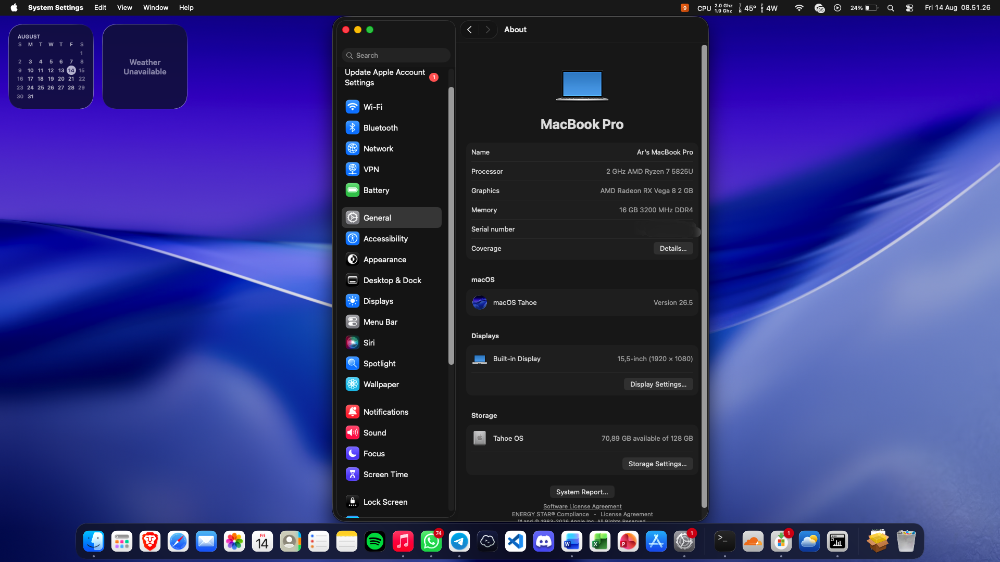
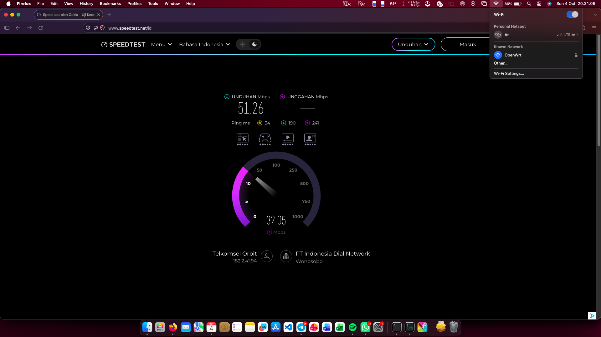

# OpenCore EFI — Infinix XBOOK 15 BL51A5

**English** | [Bahasa Indonesia](README_ID.md)

OpenCore EFI for the **Infinix XBOOK 15 BL51A5**, powered by an AMD Ryzen 7 5825U and Radeon Vega 8 integrated graphics.

This snapshot was exported from the active EFI on **November 20, 2026** and targets **macOS Tahoe 26.7.1 (25G241)**.





## macOS support

| Version | Status | Notes |
|---|---|---|
| macOS Tahoe 26.7.1 | ✅ Directly tested | Primary target of this snapshot (Darwin 25.6.0) |
| macOS Sonoma 14.8.9 | ✅ Previously tested | Verified working with native Wi-Fi legacy stack |
| macOS Sequoia 15.7 | ✅ Previously tested | Back up the EFI before switching versions |

This snapshot contains the Legacy IO80211 stack (AMFIPass + IOSkywalkFamily + IO80211FamilyLegacy) for AirPortRTW on macOS Sonoma, Sequoia, and Tahoe. Always test from a USB EFI first when updating macOS.

## Hardware

| Component | Details |
|---|---|
| Model | Infinix XBOOK 15 / BL51A5 |
| Motherboard | `EM_AB336_MB_CY_V1.0` |
| Tested BIOS | `BL51A5_AB336_XBOOK15_V1.10` |
| CPU | AMD Ryzen 7 5825U, 8 cores / 16 threads |
| iGPU | AMD Radeon Vega 8 / Barcelo, `1002:15e7` |
| Tested memory | 16 GB DDR4-3200 |
| UMA frame buffer | 2 GB (shared VRAM; carveout reported as 2 GB by the driver) |
| Storage | NVMe SSD |
| Wi-Fi | Realtek RTL8821CE PCIe, `10ec:c821` |
| Bluetooth | Realtek RTL8821C USB, `0bda:c821` |
| Ethernet | Realtek RTL8111/8168 |
| Audio | Realtek ALC269VC, layout-id 120 (kodeaqua, for Infinix XBOOK B15) |
| Trackpad | I2C HID through VoodooI2C/VoodooI2CHID |
| SMBIOS | MacBookPro16,2 |

## Feature status

| Feature | Status | Notes |
|---|---|---|
| Direct boot to macOS | ✅ Working | Picker is hidden; hold **Esc** at boot to open it for rescue tools |
| CPU 8C/16T | ✅ Working | AMD kernel patches + ForgedInvariant |
| CPU power management | ✅ Working | AMDRyzenCPUPowerManagement, SMCAMDProcessor, and SSDT-CPUR |
| Vega 8 iGPU + Metal | ✅ Working | NootedRed 1.3.2 (weachy fork); smooth video playback in Safari and browsers |
| HDMI / DisplayPort audio | ⚠️ Unverified | Redesigned in 1.3.2; no external display available to test on this unit |
| Internal display | ✅ Working | Includes backlight control and Hackintool EDID/scale injector (Display-2163-3cfb) |
| Keyboard | ✅ Working | VoodooPS2Controller |
| I2C trackpad | ✅ Working | VoodooI2C + VoodooI2CHID; individual gestures may vary |
| Brightness keys | ✅ Working | BrightnessKeys |
| Battery status | ✅ Working | SMCBatteryManager |
| NVMe | ✅ Working | NVMeFix enabled |
| Ethernet | ✅ Driver active | RealtekRTL8111 |
| RTL8821CE Wi-Fi | ✅ Working | Native Wi-Fi UI through AirPortRTW 1.3.2 (JoMei9019-real); WPA2/WPA3-Personal, auto-roaming, and hardware CCMP |
| Wi-Fi recovery | ✅ Stable | AirPortRTW reconnects reliably with a simple Wi-Fi off/on toggle |
| Realtek Bluetooth | ✅ Working on the tested unit | RealtekBluetoothFirmware + BlueToolFixup |
| Full AirDrop / AWDL / Continuity | ❌ Not reliable | AirPortRTW does not provide production-ready AWDL/Continuity support |
| Internal speakers + mic | ✅ Working | AppleALC 1.9.8, layout-id 120 (XBOOK B15). Built-in Output is now the default device and maps to the internal speakers. |
| 3.5 mm combo jack | ✅ Working | Verified with layout 120 on this unit — headphones/headset are detected correctly |
| Sleep/wake | ✅ Working on the tested unit | Retest after changing the USB map, Bluetooth stack, or macOS version |
| Docker Desktop | ✅ Working | RyzenHV 0.7.8 + PR#16, HyperKit engine, 12 CPUs / 4096 MiB VM; use `~/ryzenhv-0.7.8/docker-fix-pid.sh --restart` if HyperKit wedges |
| DRM / protected streaming content | ⚠️ Not guaranteed | Use Chromium-based browsers for Widevine; FairPlay on Safari is limited on AMD Hackintoshes |

## Boot behaviour

The boot picker is hidden so the machine boots straight into macOS:

```text
Misc > Boot > ShowPicker = false
Misc > Security > ScanPolicy = 17760515 (0x10F0103)
```

Only APFS and internal NVMe/SATA/PCI devices are scanned. This hides the Linux ext4 partition from the picker so it cannot be selected as the default. **Hold `Esc` at boot** to open the picker when you need `UEFI Shell (rescue)`.

## NootedRed and AMD notes

This snapshot uses **NootedRed 1.3.2 (weachy fork)**. From v1.2.0 onward GLFix, Metal fixes, OpenCL optimisation, VDA hardware video (AVC + HEVC), and HDMI/DP audio are enabled by default — no opt-in boot arguments are needed. All fixes are opt-out flags such as `-NRedNoVDA`, `-NRedNoGLFix`, and `-NRedDebug`.

v1.3.2 adds an event-driven `NRedAudio` pipeline that programs the DCN audio registers (Azalia, DCCG, AFMT, DP_SEC) and improves DisplayPort hotplug / monitor power-off recovery. On this unit, Safari and browser video playback is smooth and the system is responsive.

Daily-use notes:

- NootedRed must load **before AppleALC**.
- Do not use WhateverGreen or BFixup alongside NootedRed.
- AMFIPass.kext, `amfi_get_out_of_my_way=0x1`, and `csr-active-config=03080000` are retained because RyzenHV needs relaxed AMFI for HyperKit patching. Do not remove them just because newer NootedRed releases no longer require them.
- A 2 GB UMA carveout works well with 16 GB of RAM.

Snapshot boot arguments:

```text
revcpu=1 -NRedDPDelay -amfipassbeta rhv_enable_svm=1 rhv_allow_users=1 rhv_hv=1 amfi_get_out_of_my_way=0x1 ipc_control_port_options=0 rhv_selftest=1
```

- `rhv_*`: enable RyzenHV native SVM mode, allow non-root users, enable the HyperKit hypervisor, and run its self-test.
- `amfi_get_out_of_my_way=0x1` + `-amfipassbeta`: relaxed AMFI for in-memory HyperKit patching and the legacy Wi-Fi stack.
- `ipc_control_port_options=0`: compatibility option retained for Docker/HyperKit.
- `-NRedDPDelay`: workaround for display port timing delays on the internal panel.
- `revcpu=1`: CPU revision override required by the AMD patches.
- `-NRedNoVP9`: disables hardware VP9 decoding. v1.3.2 requires SIP to be fully disabled for VP9; this EFI keeps SIP relaxed (`03080000`) for RyzenHV, so VP9 is disabled to avoid `SIGKILL (Code Signature Invalid)` in Hardened Runtime apps. All other v1.3.2 features (AVC/HEVC Main10/8K, Metal, GLFix, low-VRAM optimisations, HDMI/DP audio) remain active.

## Wi-Fi and Bluetooth

This snapshot uses AirPortRTW 1.3.2 (JoMei9019-real) with the restored Legacy IO80211 stack so RTL8821CE appears in Apple's native Wi-Fi interface on Sonoma, Sequoia, and Tahoe. `AirPort_RTW88.kext` (v2.0.1) and the older FeiXiao `rtw88.kext` remain in the EFI as disabled fallbacks and must not be enabled at the same time.

Components:

| Role | Component |
|---|---|
| Wi-Fi driver | `AirPortRTW.kext` 1.3.2 (JoMei9019-real) |
| Compatibility stack | `AMFIPass.kext`, `IOSkywalkFamily.kext`, `IO80211FamilyLegacy.kext` |
| Disabled fallback | `AirPort_RTW88.kext` 2.0.1, FeiXiao `rtw88.kext` 1.0.1 + Starskiff |
| Bluetooth firmware | `RealtekBluetoothFirmware.kext` |
| Bluetooth patch for Monterey and newer | `BlueToolFixup.kext` |

AirDrop cannot be made reliable through configuration changes alone. It requires working AWDL support in both hardware and driver.

## BIOS

Use the following settings:

| Setting | Value |
|---|---|
| Secure Boot | Disabled |
| Fast Boot | Disabled |
| CSM | Disabled |
| IOMMU | Disabled |
| Above 4G Decoding | Enabled |
| UMA Frame Buffer | 2 GB recommended with 16 GB RAM |

Do not change unfamiliar engineering or advanced BIOS options. Back up the BIOS settings and EFI before experimenting.

## SMBIOS

Generate unique SMBIOS values (model `MacBookPro16,2`) with GenSMBIOS or macserial before signing in to Apple services (iCloud, iMessage, FaceTime). See `SMBIOS.txt` for details.

## Quick installation

1. Download or clone this repository.
2. Generate unique SMBIOS values and enter them in `EFI/OC/config.plist`.
3. Copy the `EFI` directory to a USB drive's EFI partition for testing.
4. Boot from the USB drive first.
5. After verifying that all essential devices work, back up the old EFI and copy this EFI to the internal EFI partition.
6. Reset NVRAM only when required after significant configuration changes.

For a fresh installation that hangs or displays a gray screen, run:

```bash
bash Extras/fix-nootedred.sh "Macintosh HD"
```

Adjust the target volume name as needed. The script should be run from Recovery.

## Main snapshot components

| Component | Version |
|---|---|
| NootedRed (weachy fork) | 1.3.2 |
| RyzenHV | 0.7.8 + PR#16 fix |
| Lilu | 1.7.2 |
| VirtualSMC | 1.3.7 |
| AppleALC | 1.9.8 (layout-id 120) |
| AirPortRTW | 1.3.2 |
| RestrictEvents | 1.1.6 |
| RealtekRTL8111 | 3.0.0 |
| AirPort_RTW88 | 2.0.1 (disabled fallback) |
| AMFIPass | 1.4.1 |
| IO80211FamilyLegacy | 12.0 |
| IOSkywalkFamily | 1.0 |
| rtw88 fallback | 1.0.1 (disabled) |
| BlueToolFixup | 2.7.2 |
| VoodooI2C | 2.9.1 |
| VoodooPS2Controller | 2.3.7 |
| AMDRyzenCPUPowerManagement | 0.7.2 |
| SMCAMDProcessor | 1.0.1 |
| SMCRadeonSensors | 2.4.0 |
| Display-2163-3cfb | Injector |

NootedRed must load **before AppleALC**. One VoodooInput instance from VoodooI2C is used; the VoodooInput, Mouse, and Trackpad plugins bundled with VoodooPS2 are disabled to avoid conflicts.

## Repository structure

```text
.
├── EFI
│   ├── BOOT
│   └── OC
│       ├── ACPI
│       ├── Backup            (local archives, intentionally excluded from this repo)
│       ├── Drivers
│       ├── Kexts
│       │   └── VERSIONS.txt
│       ├── Resources
│       ├── Tools             (OpenShell.efi rescue tool)
│       ├── config.plist
│       ├── config-legacy-wifi.plist
│       └── OpenCore.efi
├── Extras
├── README.md
├── README_ID.md
├── SMBIOS.txt
└── SOURCES.txt
```

Backup and debug files from the daily EFI are intentionally excluded from this repository.

## Sources and credits

- [OpenCorePkg](https://github.com/acidanthera/OpenCorePkg)
- [NootedRed (ChefKissInc)](https://github.com/ChefKissInc/NootedRed) / [weachy fork](https://github.com/weachy/NootedRed)
- [RyzenHV](https://github.com/overlorddev/RyzenHV)
- [AMD Vanilla](https://github.com/AMD-OSX/AMD_Vanilla)
- [VoodooI2C](https://github.com/VoodooI2C/VoodooI2C)
- Airport_RTW88, FeiXiao/rtw88, Starskiff, and RealtekBluetoothFirmware
- Acidanthera, ChefKissInc, AMD-OSX, Mieze, and the Hackintosh community

## Disclaimer

Hackintosh systems are not supported by Apple. Updating macOS, the BIOS, OpenCore, or any kext may cause boot failures, kernel panics, loss of graphics acceleration, or data loss. Always keep a bootable EFI backup and a current data backup before making changes.
