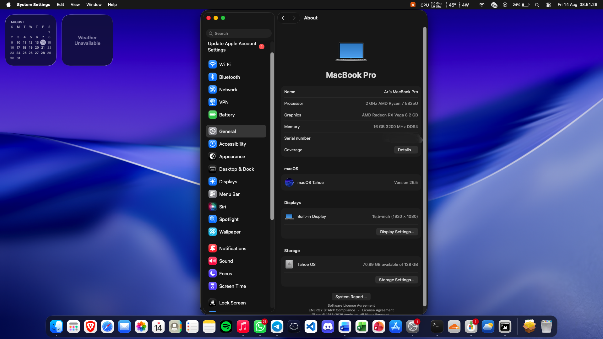
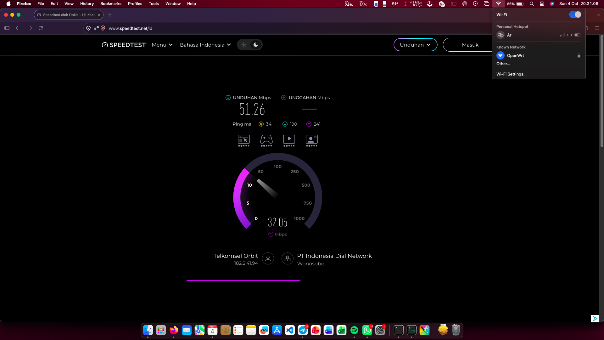

# OpenCore EFI — Infinix XBOOK 15 BL51A5

[English](README.md) | **Bahasa Indonesia**

OpenCore EFI untuk **Infinix XBOOK 15 BL51A5** dengan AMD Ryzen 7 5825U dan iGPU Radeon Vega 8.

Snapshot ini diekspor dari EFI aktif pada **20 November 2026** dan ditujukan untuk **macOS Tahoe 26.7.1 (25G241)**.





## Dukungan macOS

| Versi | Status | Catatan |
|---|---|---|
| macOS Tahoe 26.7.1 | ✅ Diuji langsung | Target utama snapshot ini (Darwin 25.6.0) |
| macOS Sonoma 14.8.9 | ✅ Pernah diuji | Terverifikasi bekerja dengan legacy stack Wi-Fi |
| macOS Sequoia 15.7 | ✅ Pernah diuji | Backup EFI sebelum berpindah versi |

Snapshot ini menyertakan Legacy IO80211 stack (AMFIPass + IOSkywalkFamily + IO80211FamilyLegacy) untuk AirPortRTW pada macOS Sonoma, Sequoia, dan Tahoe. Jangan menganggap konfigurasi Wi-Fi yang sama cocok untuk macOS lebih baru tanpa mengujinya dari USB EFI terlebih dahulu.

## Hardware

| Komponen | Detail |
|---|---|
| Model | Infinix XBOOK 15 / BL51A5 |
| Motherboard | `EM_AB336_MB_CY_V1.0` |
| BIOS teruji | `BL51A5_AB336_XBOOK15_V1.10` |
| CPU | AMD Ryzen 7 5825U, 8 core / 16 thread |
| iGPU | AMD Radeon Vega 8 / Barcelo, `1002:15e7` |
| RAM saat pengujian | 16 GB DDR4-3200 |
| UMA frame buffer | 2 GB (VRAM bersama; driver melaporkan carveout 2 GB) |
| Storage | NVMe SSD |
| Wi-Fi | Realtek RTL8821CE PCIe, `10ec:c821` |
| Bluetooth | Realtek RTL8821C USB, `0bda:c821` |
| Ethernet | Realtek RTL8111/8168 |
| Audio | Realtek ALC269VC, layout-id 120 (kodeaqua, untuk Infinix XBOOK B15) |
| Trackpad | I2C HID melalui VoodooI2C/VoodooI2CHID |
| SMBIOS | MacBookPro16,2 |

## Status fitur

| Fitur | Status | Catatan |
|---|---|---|
| Boot langsung ke macOS | ✅ Bekerja | Picker disembunyikan; tahan **Esc** saat boot untuk membukanya (rescue tools) |
| CPU 8C/16T | ✅ Bekerja | Kernel patch AMD + ForgedInvariant |
| CPU power management | ✅ Bekerja | AMDRyzenCPUPowerManagement, SMCAMDProcessor, dan SSDT-CPUR |
| iGPU Vega 8 + Metal | ✅ Bekerja | NootedRed 1.3.0 (fork weachy); video Safari/browser berjalan halus |
| Audio HDMI / DisplayPort | ⚠️ Belum diverifikasi | Didesain ulang di 1.3.0; tidak ada monitor eksternal untuk diuji di unit ini |
| Internal display | ✅ Bekerja | Termasuk backlight dan injektor EDID/resolusi Hackintool (Display-2163-3cfb) |
| Keyboard | ✅ Bekerja | VoodooPS2Controller |
| Trackpad I2C | ✅ Bekerja | VoodooI2C + VoodooI2CHID; gesture tertentu dapat berbeda |
| Brightness keys | ✅ Bekerja | BrightnessKeys |
| Battery status | ✅ Bekerja | SMCBatteryManager |
| NVMe | ✅ Bekerja | NVMeFix aktif |
| Ethernet | ✅ Driver aktif | RealtekRTL8111 |
| Wi-Fi RTL8821CE | ✅ Bekerja | UI Wi-Fi native melalui AirPortRTW 1.3.0 (JoMei9019-real); WPA2/WPA3-Personal, auto-roaming, dan hardware CCMP |
| Recovery Wi-Fi | ✅ Stabil | AirPortRTW tersambung kembali cukup dengan toggle Wi-Fi off/on |
| Bluetooth Realtek | ✅ Bekerja pada unit pengujian | RealtekBluetoothFirmware + BlueToolFixup |
| AirDrop / AWDL / Continuity penuh | ❌ Tidak andal | AirPortRTW belum menyediakan dukungan AWDL/Continuity yang siap dipakai harian |
| Speaker + mic internal | ✅ Bekerja | AppleALC 1.9.8, layout-id 120 (XBOOK B15). Built-in Output sekarang jadi device default dan memetakan ke speaker internal. |
| Jack combo 3,5 mm | ✅ Bekerja | Terverifikasi dengan layout 120 di unit ini — headphone/headset terdeteksi dengan benar |
| Sleep/wake | ✅ Bekerja pada unit pengujian | Tetap uji setelah mengubah USB mapping, Bluetooth, atau versi macOS |
| Docker Desktop | ✅ Bekerja | RyzenHV 0.7.8 + PR#16, engine HyperKit, VM 12 CPU / 4096 MiB; jalankan `~/ryzenhv-0.7.8/docker-fix-pid.sh --restart` jika HyperKit macet |
| DRM / streaming protected content | ⚠️ Tidak dijamin | Gunakan browser berbasis Chromium untuk Widevine; FairPlay di Safari terbatas di AMD Hackintosh |

## Perilaku boot

Boot picker disembunyikan agar mesin langsung masuk ke macOS:

```text
Misc > Boot > ShowPicker = false
Misc > Security > ScanPolicy = 17760515 (0x10F0103)
```

Hanya APFS dan perangkat NVMe/SATA/PCI internal yang dipindai. Ini menyembunyikan partisi Linux (ext4) dari picker agar tidak terpilih sebagai default. **Tahan `Esc` saat boot** untuk membuka picker saat membutuhkan `UEFI Shell (rescue)`.

## Catatan NootedRed dan AMD

Snapshot ini memakai **NootedRed 1.3.0 (fork weachy)**. Mulai v1.2.0, GLFix, perbaikan Metal, optimasi OpenCL, VDA hardware video (AVC + HEVC), dan audio HDMI/DP aktif secara default — tidak perlu boot argument khusus. Semua perbaikan bersifat opt-out lewat flag seperti `-NRedNoVDA`, `-NRedNoGLFix`, dan `-NRedDebug`.

v1.3.0 menambahkan pipeline `NRedAudio` berbasis event yang memprogram register audio DCN (Azalia, DCCG, AFMT, DP_SEC) serta perbaikan hotplug DisplayPort dan recovery saat monitor dimatikan. Di unit ini, pemutaran video di Safari/browser berjalan halus dan sistem terasa responsif.

Catatan harian:

- NootedRed harus dimuat **sebelum AppleALC**.
- Jangan pakai WhateverGreen atau BFixup bersamaan dengan NootedRed.
- AMFIPass.kext, `amfi_get_out_of_my_way=0x1`, dan `csr-active-config=03080000` tetap dipertahankan karena RyzenHV membutuhkan AMFI rileks untuk patching HyperKit di memori. Jangan hapus hanya karena rilis NootedRed terbaru tidak lagi mensyaratkannya.
- UMA 2 GB bekerja baik dengan RAM 16 GB.

Boot arguments snapshot ini:

```text
revcpu=1 -NRedDPDelay -amfipassbeta rhv_enable_svm=1 rhv_allow_users=1 rhv_hv=1 amfi_get_out_of_my_way=0x1 ipc_control_port_options=0 rhv_selftest=1
```

- `rhv_*`: mengaktifkan mode SVM native RyzenHV, mengizinkan user non-root, mengaktifkan hypervisor HyperKit, dan menjalankan self-test-nya.
- `amfi_get_out_of_my_way=0x1` + `-amfipassbeta`: AMFI rileks untuk patching HyperKit di memori dan legacy Wi-Fi stack.
- `ipc_control_port_options=0`: opsi kompatibilitas yang tetap dipakai untuk Docker/HyperKit.
- `-NRedDPDelay`: mengatasi delay display port timing pada panel internal.
- `revcpu=1`: override revisi CPU yang dibutuhkan patch AMD.
- `-NRedNoVP9`: mematikan decoding VP9 hardware. v1.3.0 mensyaratkan SIP benar-benar mati untuk VP9; EFI ini menjaga SIP relaxed (`03080000`) untuk RyzenHV, maka VP9 dimatikan agar aplikasi Hardened Runtime tidak `SIGKILL (Code Signature Invalid)`. Fitur lain v1.3.0 (AVC/HEVC Main10/8K, Metal, GLFix, optimasi VRAM rendah, audio HDMI/DP) tetap aktif.

## Wi-Fi dan Bluetooth

Snapshot ini memakai AirPortRTW 1.3.0 (JoMei9019-real) bersama Legacy IO80211 stack sehingga RTL8821CE tampil di UI Wi-Fi native Apple pada Sonoma, Sequoia, dan Tahoe. `AirPort_RTW88.kext` (v2.0.1) dan `rtw88.kext` FeiXiao lama tetap disimpan sebagai fallback dalam keadaan disabled dan tidak boleh diaktifkan bersamaan.

Komponen:

| Peran | Komponen |
|---|---|
| Driver Wi-Fi | `AirPortRTW.kext` 1.3.0 (JoMei9019-real) |
| Compatibility stack | `AMFIPass.kext`, `IOSkywalkFamily.kext`, `IO80211FamilyLegacy.kext` |
| Fallback disabled | `AirPort_RTW88.kext` 2.0.1, FeiXiao `rtw88.kext` 1.0.1 + Starskiff |
| Firmware Bluetooth | `RealtekBluetoothFirmware.kext` |
| Patch Bluetooth Monterey+ | `BlueToolFixup.kext` |

AirDrop tidak dapat dibuat andal hanya dengan mengubah config. Dibutuhkan dukungan AWDL yang bekerja pada hardware dan driver.

## BIOS

Gunakan pengaturan berikut:

| Setting | Nilai |
|---|---|
| Secure Boot | Disabled |
| Fast Boot | Disabled |
| CSM | Disabled |
| IOMMU | Disabled |
| Above 4G Decoding | Enabled |
| UMA Frame Buffer | 2 GB disarankan untuk RAM 16 GB |

Jangan mengubah menu engineer/advanced yang tidak dipahami. Backup setting BIOS dan EFI sebelum eksperimen.

## SMBIOS

Generate nilai SMBIOS sendiri (model `MacBookPro16,2`) menggunakan GenSMBIOS atau macserial sebelum login ke layanan Apple (iCloud, iMessage, FaceTime). Detail panduan ada di `SMBIOS.txt`.

## Instalasi singkat

1. Download atau clone repo ini.
2. Generate SMBIOS unik dan isi `EFI/OC/config.plist`.
3. Copy folder `EFI` ke partisi EFI USB untuk pengujian.
4. Boot dari USB terlebih dahulu.
5. Jika seluruh perangkat utama bekerja, backup EFI lama lalu copy EFI ini ke partisi internal.
6. Reset NVRAM hanya ketika memang diperlukan setelah perubahan config besar.

Untuk fresh install yang mengalami gray screen/hang, jalankan:

```bash
bash Extras/fix-nootedred.sh "Macintosh HD"
```

Sesuaikan nama volume target. Script sebaiknya dijalankan dari Recovery.

## Komponen utama snapshot

| Komponen | Versi |
|---|---|
| NootedRed (fork weachy) | 1.3.0 |
| RyzenHV | 0.7.8 + perbaikan PR#16 |
| Lilu | 1.7.2 |
| VirtualSMC | 1.3.7 |
| AppleALC | 1.9.8 (layout-id 120) |
| AirPortRTW | 1.3.0 |
| RestrictEvents | 1.1.6 |
| RealtekRTL8111 | 3.0.0 |
| AirPort_RTW88 | 2.0.1 (fallback disabled) |
| AMFIPass | 1.4.1 |
| IO80211FamilyLegacy | 12.0 |
| IOSkywalkFamily | 1.0 |
| rtw88 fallback | 1.0.1 (disabled) |
| BlueToolFixup | 2.7.2 |
| VoodooI2C | 2.9.1 |
| VoodooPS2Controller | 2.3.7 |
| AMDRyzenCPUPowerManagement | 0.7.2 |
| SMCAMDProcessor | 1.0.1 |
| SMCRadeonSensors | 2.4.0 |
| Display-2163-3cfb | Injector |

NootedRed harus dimuat **sebelum AppleALC**. Satu instance VoodooInput dari VoodooI2C digunakan; plugin VoodooInput, Mouse, dan Trackpad milik VoodooPS2 dinonaktifkan untuk menghindari konflik.

## Struktur repo

```text
.
├── EFI
│   ├── BOOT
│   └── OC
│       ├── ACPI
│       ├── Backup            (arsip lokal, sengaja tidak masuk repo)
│       ├── Drivers
│       ├── Kexts
│       │   └── VERSIONS.txt
│       ├── Resources
│       ├── Tools             (OpenShell.efi rescue tool)
│       ├── config.plist
│       ├── config-legacy-wifi.plist
│       └── OpenCore.efi
├── Extras
├── README.md
├── README_ID.md
├── SMBIOS.txt
└── SOURCES.txt
```

File backup/debug dari EFI harian sengaja tidak ikut dimasukkan ke repo ini.

## Sumber dan kredit

- [OpenCorePkg](https://github.com/acidanthera/OpenCorePkg)
- [NootedRed (ChefKissInc)](https://github.com/ChefKissInc/NootedRed) / [fork weachy](https://github.com/weachy/NootedRed)
- [RyzenHV](https://github.com/overlorddev/RyzenHV)
- [AMD Vanilla](https://github.com/AMD-OSX/AMD_Vanilla)
- [VoodooI2C](https://github.com/VoodooI2C/VoodooI2C)
- Airport_RTW88, FeiXiao/rtw88, Starskiff, dan RealtekBluetoothFirmware
- Acidanthera, ChefKissInc, AMD-OSX, Mieze, dan komunitas Hackintosh

## Disclaimer

Hackintosh tidak didukung Apple. Update macOS, BIOS, OpenCore, atau kext dapat menyebabkan gagal boot, kernel panic, kehilangan akselerasi, atau kehilangan data. Selalu simpan EFI bootable cadangan dan backup data sebelum melakukan perubahan.
